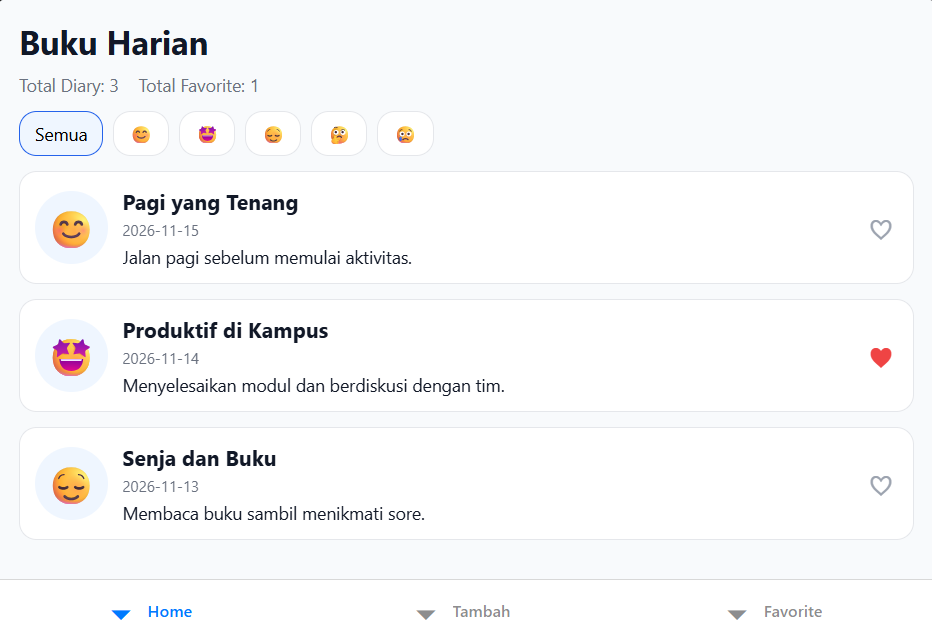
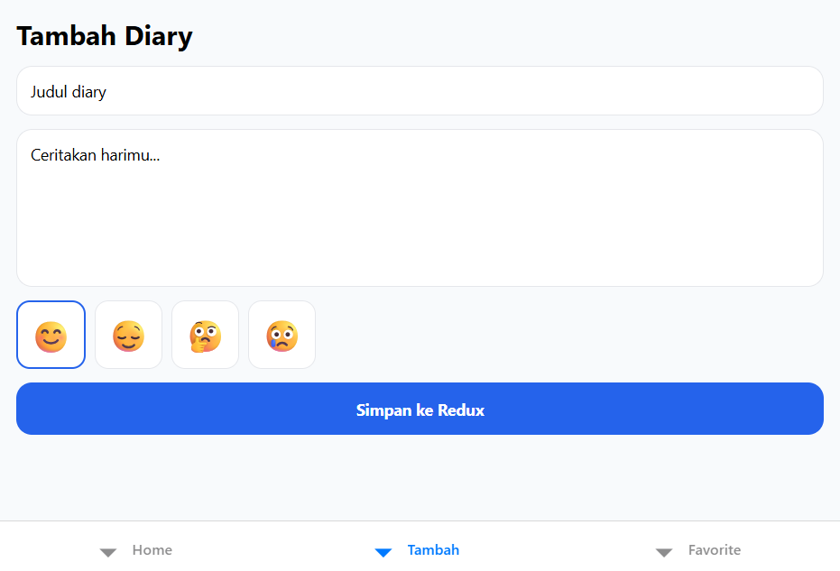
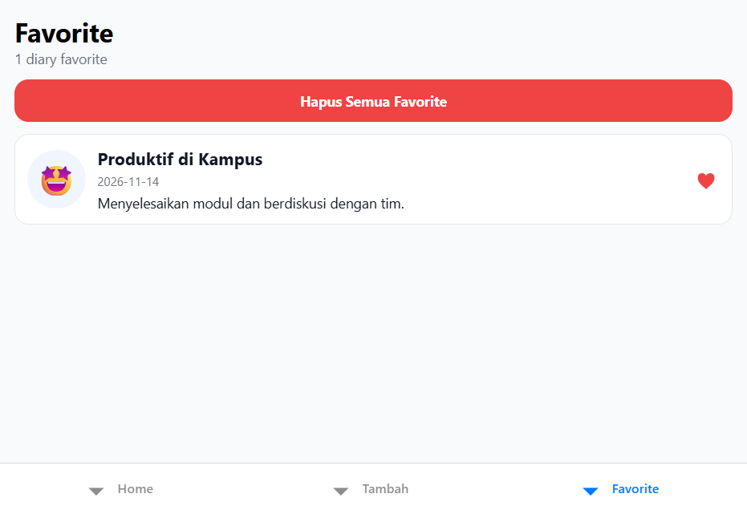

# Diary App — Praktikum 08 Redux Toolkit

Diary App adalah aplikasi jurnal harian berbasis React Native dan Expo Router. Aplikasi ini dibuat untuk menerapkan konsep **global state management** menggunakan Redux Toolkit dan React-Redux.

Sesuai tujuan Modul Praktikum 08, data diary dan status favorite dikelola secara terpusat di Redux Store. Form tambah dan edit tetap menggunakan local state karena input tersebut hanya dibutuhkan oleh screen terkait. Aplikasi ini belum menggunakan backend atau database persisten, sehingga perubahan data akan kembali ke data awal setelah aplikasi di-reload atau direstart.

## Tujuan pembelajaran

- Memahami perbedaan local state, global state, dan persistent database.
- Membuat Redux Store dengan `configureStore()`.
- Membuat feature slice dengan `createSlice()`.
- Menggunakan action, reducer, dispatch, selector, dan Provider.
- Menerapkan typed hooks `useAppDispatch` dan `useAppSelector` pada TypeScript.
- Menghubungkan state diary pada beberapa screen melalui Expo Router.

## Fitur aplikasi

- Menampilkan daftar diary pada halaman Home.
- Menambah diary baru dengan judul, isi, tanggal, dan mood.
- Memvalidasi judul minimal tiga karakter dan isi diary wajib diisi.
- Menandai atau menghapus status favorite.
- Menampilkan statistik Total Diary dan Total Favorite.
- Memfilter diary berdasarkan mood.
- Melihat detail diary.
- Mengedit dan menghapus diary.
- Menghapus seluruh favorite sekaligus.

## Bukti aplikasi berjalan

### SS1 — Home, statistik, dan filter mood



### SS2 — Form Tambah Diary



### SS3 — Halaman Favorite



## Struktur state

### Local state

`useState` digunakan untuk menyimpan isi sementara pada form Create dan Edit, yaitu `title`, `body`, dan `mood`. Data ketikan tidak langsung masuk ke Redux Store.

### Global Redux state

Redux Toolkit menyimpan daftar `entries`, status `liked`, filter diary, dan filter mood. State ini dapat dibaca dan diubah oleh Home, Create, Favorites, Detail, dan Edit melalui typed hooks.

### Persistent database

Persistent database adalah penyimpanan permanen seperti SQLite, REST API, Firebase, atau MySQL. Fitur tersebut belum digunakan pada praktikum ini. Redux Store hanya menyimpan data selama aplikasi berjalan di memory.

## Menjalankan aplikasi

Pastikan Node.js sudah terpasang, kemudian jalankan:

```bash
npm install
npx expo start
```

Untuk membersihkan cache Metro saat terjadi masalah route atau bundling:

```bash
npx expo start -c
```

## Verifikasi proyek

```bash
npx tsc --noEmit
npx expo lint
npx expo export --platform web
```

## Teknologi

- React Native
- Expo SDK 58
- Expo Router
- TypeScript
- Redux Toolkit
- React-Redux
